## Campo de tração diagonal {.semester-map}

:::::::::: semester-grid
::: {.semester-item}
[01 · Introdução]{.semester-card-title}
:::

::: {.semester-item}
[02 · Tração diagonal pura]{.semester-card-title}
:::

::: {.semester-item}
[03 · Tração diagonal incompleta]{.semester-card-title}
:::

::::::::::

```{python}
#| echo: false
#| include: false

import matplotlib.pyplot as plt

plt.rcParams["font.family"] = "Figtree"    # ou uma sans-serif próxima
plt.rcParams["font.size"] = 14            # tamanho base
plt.rcParams["axes.titlesize"] = 16       # títulos de eixos/plots
plt.rcParams["axes.labelsize"] = 14
plt.rcParams["xtick.labelsize"] = 12
plt.rcParams["ytick.labelsize"] = 12
plt.rcParams["legend.fontsize"] = 18

BLACK = "#2a2a2a"
BLUE = "#1f77b4"
GREEN = "#59a89c"
AMBAR = "#f0c571"
PURPLE = "#a559aa"
RED = "#e02b35"
GRAY = "#cecece"
```

<!-- ============================================================================================================================== -->
<!-- ============================================================================================================================== -->
<!-- ============================================================================================================================== -->

## Introdução

:::::: columns
::: {.column width="50%"}

Vigas como as longarinas de aeronaves são normalmente constituídas por [flanges (mesas)]{.focus} conectadas por uma [alma]{.focus} de baixa espessura, [reforçada verticalmente]{.focus} a intervalos.

Nas vigas com [alma resistente à flambagem]{.focus}, as tensões presentes neste elemento devem permanecer abaixo de valores admissíveis para este critério.

Neste caso, as cargas admissíveis podem ser elevadas a partir de duas principais variações no projeto: [elevar a espessura da alma ou reduzir as dimensões dos painéis]{.focus}, com a inclusão de mais reforçadores verticais.

:::

::: {.column width="5%"}
:::

::: {.column width="45%"}
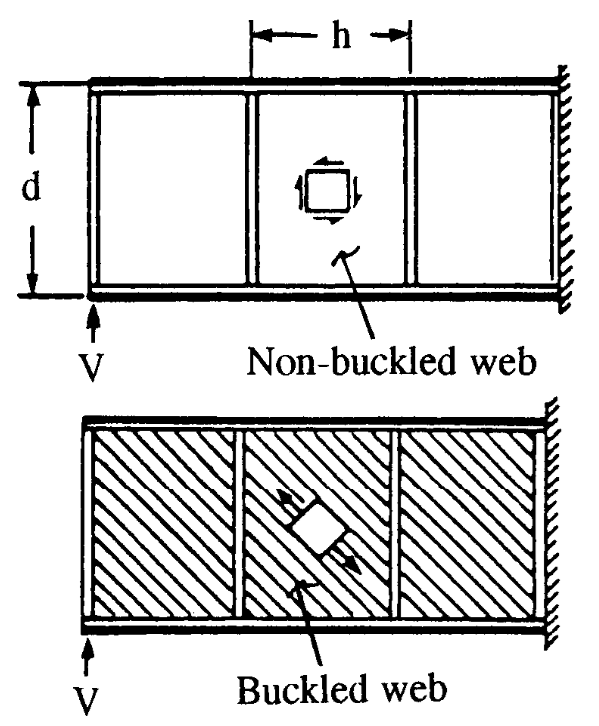{fig-align="center" width="70%"}
:::
::::::


<!-- ============================================================================================================================== -->
<!-- ============================================================================================================================== -->
<!-- ============================================================================================================================== -->


## Projeto de vigas resistentes à flambagem: alma

:::::: columns
::: {.column width="50%"}

No projeto das almas resistentes à flambagem devem ser realizadas três observações:

1\. Comparar as tensões de cisalhamento presentes $\sigma_s = W Q / I t$ ou (aproximadamente $W / t d$) com os limites de falha do material.

2\. Avaliar a resistência dos elementos de união.

3\. Avaliar os [limites de flambagem de cada seção da alma]{.focus} utilizando as relações clássicas de flambagem de placas ou cascas (se tratando de um revestimento):

$$
\sigma_{cr} = \frac{k_s \pi^2 E}{12(1 - \nu^2)}\left(\frac{t}{b})\right)
$$
:::

::: {.column width="5%"}
:::

::: {.column width="45%"}
{fig-align="center" width="70%"}
:::
::::::

<!-- ============================================================================================================================== -->
<!-- ============================================================================================================================== -->
<!-- ============================================================================================================================== -->

## Projeto de vigas resistentes à flambagem: mesas

:::::: columns
::: {.column width="50%"}

De modo geral, as mesas ou flanges, devem apresentar inércia o suficiente para [resistir à flexão]{.focus} imposta à longarina.

Tipicamente, temos a mesa inferior trabalhando sob tração e sendo avaliada sobre escoamento do material; a mesa superior, trabalhando sob compressão, deve ser avaliada sob [escoamento e também sob estabilidade local]{.focus}.

Quando a dimensão das mesas é pequena quando comparada com a altura da viga, podemos aproximar as tensões nestes elementos a partir da relação $\sigma = M / h_e A_f$ onde $h_e$ é a altura da viga medida entre os centróides das mesas e $A_f$ é a área destas.


:::
::: {.column width="5%"}
:::

::: {.column width="45%"}
{fig-align="center" width="70%"}
:::
::::::


<!-- ============================================================================================================================== -->
<!-- ============================================================================================================================== -->
<!-- ============================================================================================================================== -->


## Projeto de vigas resistentes à flambagem: reforçadores verticais

:::::: columns
::: {.column width="50%"}

Na ausência de cargas externas aplicadas sobre eles, [a função dos reforçadores verticais é reduzir as dimensões efetivas dos painéis formados na alma]{.focus}, conferindo-os maior resistência a flambagem.

Para cumprir esta função, eles devem apresentar uma certa rigidez mínima necessária; que pode ser determinada a partir da equação de Wagner descrevendo a momento de inércia do reforçador $I_v$ em função da distância entre os reforçadores $b$, da altura da alma $h_e$, da força cortante na seção $V$, da espessura da alma $t$ e do módulo de elasticidade do material $E$.

Observa-se que a razão entre o espaçamento dos reforçadores e altura da alma normalmente se encontra entre 0,2 e 1,0.

:::
::: {.column width="5%"}
:::

::: {.column width="45%"}
$$
I_v = \frac{2{,}29\,d}{t}\,
      \frac{V\,h_w^{4/3}}{33E}
$$


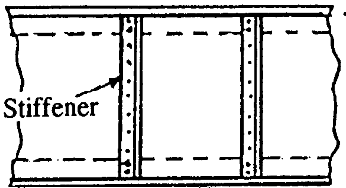{fig-align="center" width="70%"}
:::
::::::


<!-- ============================================================================================================================== -->
<!-- ============================================================================================================================== -->
<!-- ============================================================================================================================== -->


## Projeto de vigas resistentes à flambagem: reforçadores verticais


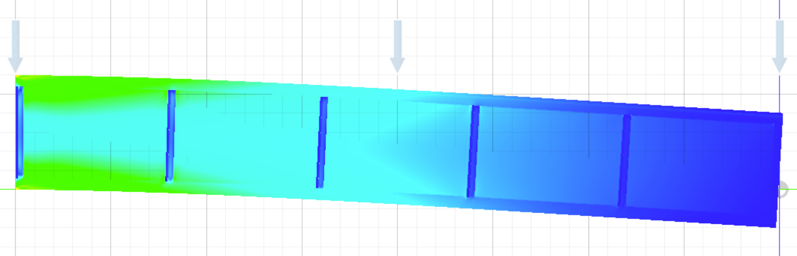{fig-align="center" width="90%"}


<!-- ============================================================================================================================== -->
<!-- ============================================================================================================================== -->
<!-- ============================================================================================================================== -->


## Tração diagonal

:::::: columns
::: {.column width="50%"}

Em alguns projetos de vigas, ou elementos de revestimento reforçados, [considera-se que a alma, ou revestimento de baixa espessura, possa sofrer flambagem]{.focus} assumindo um estado de tensão chamado de [tração diagonal]{.focus}.

No entanto, suportada por flanges, reforçadores ou cavernas estes elementos flambados [ainda oferecem resistência ao carregamento.]{.focus}

Neste estado, os elementos reforçadores sofrem então cargas adicionais, de modo a acomodar a flambagem da alma.
:::

::: {.column width="5%"}
:::

::: {.column width="45%"}
::: {.panel-tabset}

### Viga

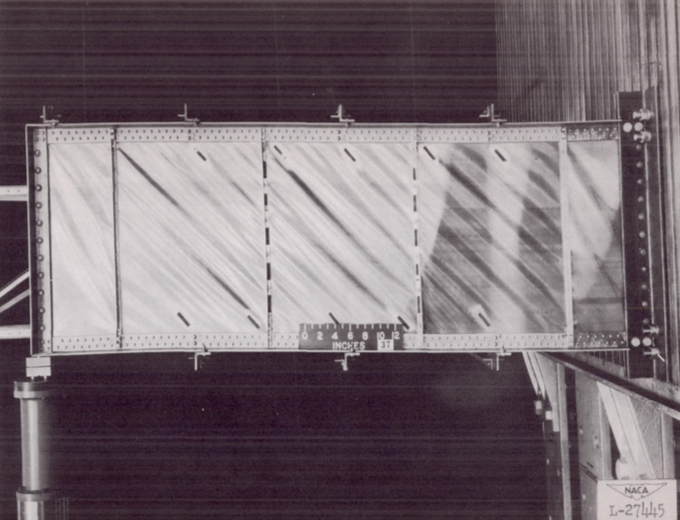{height=450px fig-align="center"}

### Revestimento

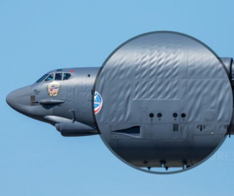{height=450px fig-align="center"}

### Revestimento

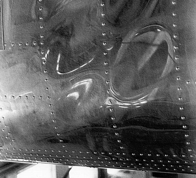{height=450px fig-align="center"}

### Analogia

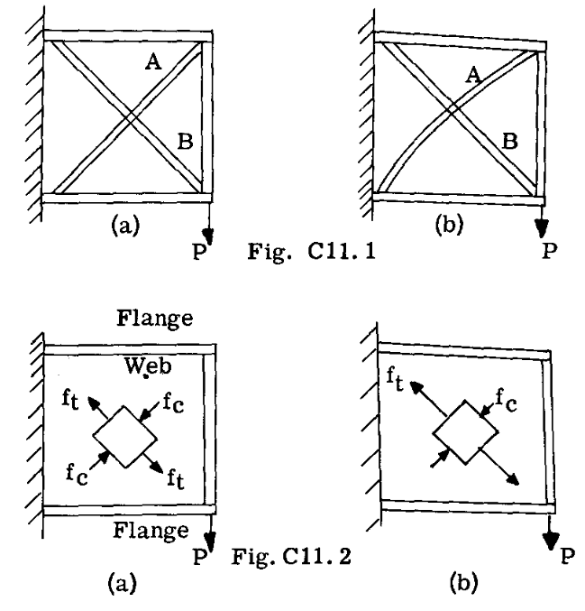{height=450px fig-align="center"width="80%"}
:::
:::
::::::


<!-- ============================================================================================================================== -->
<!-- ============================================================================================================================== -->
<!-- ============================================================================================================================== -->


## Tração diagonal pura: Teoria de Wagner

:::::: columns
::: {.column width="50%"}

Em um estado de tração diagonal pura, consideramos uma total perda de capacidade resistiva da alma perpendicular às meias ondas de flambagem (diagonal secundária).

Consideramos um caso idealizado, onde as flanges suportam todo o carregamento de flexão enquanto alma suporta os esforços cisalhantes.

Sob estas considerações, com carga pontual $W$ uma tensão de cisalhamento $\tau$ uniforme se distribui sobre a alma de espessura $t$ e contida entre flanges espaçadas em $d$.

$$
\tau = \frac{W}{t d}
$$
:::

::: {.column width="5%"}
:::

::: {.column width="45%"}
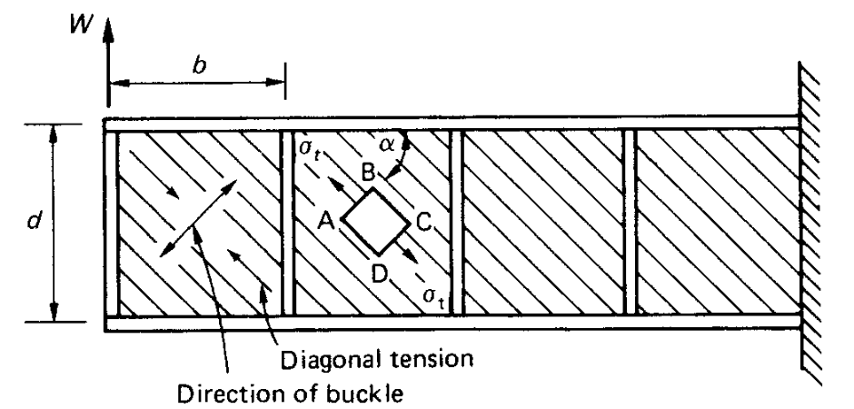{fig-align="center" width="100%"}
:::
::::::

<!-- ============================================================================================================================== -->
<!-- ============================================================================================================================== -->
<!-- ============================================================================================================================== -->


## Teoria de Wagner: tensão de tração diagonal

:::::: columns
::: {.column width="60%"}

Para entender a redistribuição de tensões em um caso de tração diagonal pura vamos observar um pequeno elemento ABCD da alma, no qual identificamos a [tensão de tração diagonal $\sigma_t$]{.focus} orientada a um [ângulo de tração diagonal $\alpha$]{.focus} na alma.

A partir de um equilíbrio de forças verticais, a tensão $\sigma_t$ pode ser calculada em função da tensão de cisalhamento presente na alma.

$$
\sigma_t = \frac{\tau}{\sin{\alpha} \cos{\alpha}}
$$

Aplicação a relação para a tensão de cilhamento podemos obter a tensão de tração diagonal em função do carregamento externo $W$. 
$$
\sigma_t = \frac{2 W}{t d \sin{2 \alpha}}
$$
:::

::: {.column width="4%"}
:::

::: {.column width="36%"}
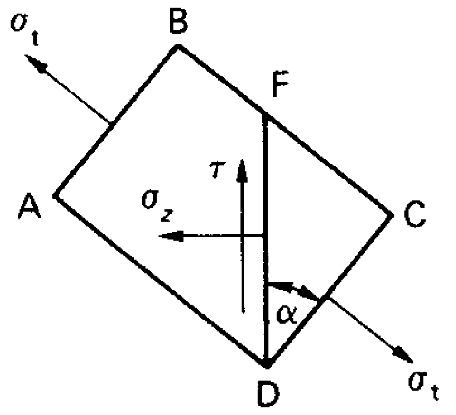{fig-align="center" width="80%"}
:::
::::::

<!-- ============================================================================================================================== -->
<!-- ============================================================================================================================== -->
<!-- ============================================================================================================================== -->


## Teoria de Wagner: tensão de tração diagonal

:::::: columns
::: {.column width="60%"}

A partir da definição da tensão de tração diagonal, podemos identificar tensões $\sigma_z$ na horizontal e $\sigma_y$ na vertical, mantendo o equilíbrio no elemento ABCD.

Estas tensões de equilíbrio serão comunicadas aos elementos reforçadores adjacentes.

Considerando uma tensão $\sigma_z$ no elemento seccionado verticalmente, podemos calcular seu valor em função da tensão de cisalhamento ou do carregamento externo diretamente.

$$
\sigma_z = \frac{\tau}{\tan{\alpha}} = \frac{W}{t d \tan{\alpha}}
$$
:::

::: {.column width="4%"}
:::

::: {.column width="36%"}
{fig-align="center" width="80%"}
:::
::::::

<!-- ============================================================================================================================== -->
<!-- ============================================================================================================================== -->
<!-- ============================================================================================================================== -->


## Teoria de Wagner: cargas primárias nas flanges

:::::: columns
::: {.column width="54%"}

Considerando uma tensão $\sigma_z$ constante ao longo da alma podemos inferir os carregamentos $F_T$ e $F_B$ totais nas flanges a partir do equilíbrio de momentos.

Nota-se que os carregamentos totais nas flanges são então produzidos por uma combinação do momento fletor gerado pelo carregamento externo e do carregamento adicional resultante do estado de tração diagonal puro.

Na flange superior observamos um incremento no carregamento enquanto na inferior um alívio do carregamento.

$$
F_T = \frac{W z}{d} + \frac{W}{2 \tan{\alpha}} 
\qquad \text{e} \qquad 
F_B = \frac{W z}{d} - \frac{W}{2 \tan{\alpha}}
$$
:::

::: {.column width="4%"}
:::

::: {.column width="42%"}
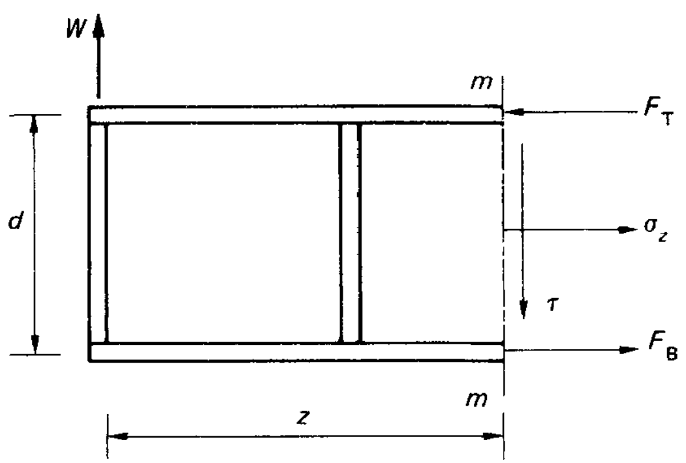{fig-align="center" width="100%"}
:::
::::::

<!-- ============================================================================================================================== -->
<!-- ============================================================================================================================== -->
<!-- ============================================================================================================================== -->

## Teoria de Wagner: cargas primárias nos reforçadores verticais

:::::: columns
::: {.column width="60%"}

Avaliamos novamente um elemento da alma, agora seccionado horizontalmente, onde a tensão $\sigma_y$ pode ser obtida em um equilíbrio de forças vertical.

$$
\sigma_y = \tau \tan{\alpha} = \frac{W \tan{\alpha}}{t d}
$$

Podemos assumir que cada reforçador vertical deve suportar uma carga compressiva $P$ equilibrando a resultante das tensões $\sigma_y$ atuantes nos painéis da alma adjacentes.

Considerando uma tensão $\sigma_y$ constante na alma e que cada reforçador suporte metade de seus painéis adjacentes temos a seguinte relação:

$$
P = \frac{W b \tan{\alpha}}{d}
$$
:::

::: {.column width="4%"}
:::

::: {.column width="36%"}
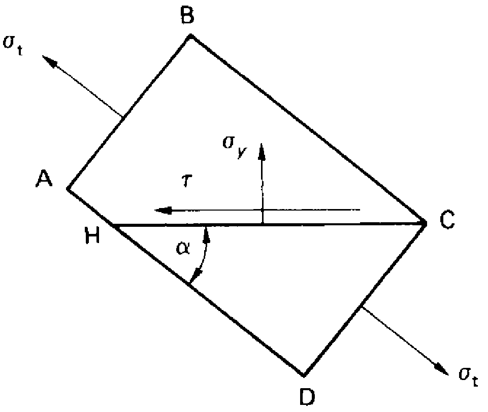{fig-align="center" width="80%"}
:::
::::::

<!-- ============================================================================================================================== -->
<!-- ============================================================================================================================== -->
<!-- ============================================================================================================================== -->

## Teoria de Wagner: cargas primárias nos reforçadores verticais

:::::: columns
::: {.column width="60%"}

A carga compressiva nos reforçadores, além de ser verificada a escoamento do material, pode também causar a flabagem destes elementos.

No entanto, a interação da flambagem da alma com a flambagem do reforçador torna necessário um ajuste sobre o seu comprimento efetivo.

$$
l_e =
\begin{cases}
\dfrac{d}{\sqrt{4-2b/d}},
& \text{para } b \leq 1{,}5d, \\[8pt]
d,
& \text{para } b \geq 1{,}5d.
\end{cases}
$$

:::

::: {.column width="4%"}
:::

::: {.column width="36%"}
{fig-align="center" width="80%"}
:::
::::::

<!-- ============================================================================================================================== -->
<!-- ============================================================================================================================== -->
<!-- ============================================================================================================================== -->

## Teoria de Wagner: cargas secundárias nas flanges {.knockdown-slide}

:::::: columns
::: {.column width="48%"}

As tensões distribuídas $\sigma_y$ além de compressão direta nos reforçadores verticais, também produzem flexão nas flanges entre estes reforçadores.

Cada seção de flange atua como uma viga engastada portanto um carregamento uniformemente distribuído de intensidade $\sigma_y t$.

Nestas condições, um momento máximo na flange pode ser determinado nos arredores dos reforçadores verticais.

$$
M_{max} = \frac{\sigma_y t b^2}{12} = \frac{W b^2 \tan{\alpha}}{12 d}
$$
:::

::: {.column width="4%"}
:::

::: {.column width="48%"}
```{python}
#| echo: false
#| fig-format: svg
#| fig-align: center
#| out-width: "100%"

import numpy as np
import matplotlib.pyplot as plt
from matplotlib import font_manager

fontes = {f.name for f in font_manager.fontManager.ttflist}
fonte = "Figtree" if "Figtree" in fontes else "DejaVu Sans"

azul = "#1f77b4"
preto = "#2a2a2a"

xi = np.linspace(0.0, 1.0, 601)
momento = -1.0 + 6.0 * xi - 6.0 * xi**2
zeros = np.array([
    (3.0 - np.sqrt(3.0)) / 6.0,
    (3.0 + np.sqrt(3.0)) / 6.0,
])

with plt.rc_context({
    "font.family": fonte,
    "font.size": 13,
    "axes.labelsize": 14,
    "mathtext.fontset": "dejavusans",
    "axes.spines.top": False,
    "axes.spines.right": False,
    "svg.fonttype": "none",
}):
    fig, (ax_esq, ax) = plt.subplots(
        2, 1,
        figsize=(8.5, 5.8),
        gridspec_kw={"height_ratios": [1.0, 3.6]},
        layout="constrained",
    )

    # Esquema de um trecho com rotações impedidas
    ax_esq.hlines(
    y=0.0,
    xmin=0.0,
    xmax=1.0,
    color=preto,
    linewidth=4,
)

    for extremidade, sentido in [(0.0, -1.0), (1.0, 1.0)]:
        ax_esq.plot(
            [extremidade, extremidade],
            [-0.15, 0.20],
            color=preto, lw=2,
        )

        for y_h in np.linspace(-0.13, 0.17, 6):
            ax_esq.plot(
                [extremidade, extremidade + sentido * 0.025],
                [y_h, y_h - 0.055],
                color=preto, lw=1,
            )

    for x_carga in np.linspace(0.06, 0.94, 13):
        ax_esq.annotate(
            "",
            xy=(x_carga, 0.015),
            xytext=(x_carga, 0.30),
            arrowprops=dict(
                arrowstyle="->", color=azul, lw=1.3,
            ),
        )

    ax_esq.text(
        0.5, 0.35,
        r"$q=\sigma_y t$",
        ha="center", va="bottom",
    )

    ax_esq.text(
        0.0, -0.24, "Reforçador",
        ha="center", va="top", fontsize=11,
    )
    ax_esq.text(
        1.0, -0.24, "Reforçador",
        ha="center", va="top", fontsize=11,
    )

    ax_esq.set_xlim(-0.08, 1.08)
    ax_esq.set_ylim(-0.43, 0.53)
    ax_esq.axis("off")

    # Diagrama adimensional de momento
    ax.axhline(0, color=preto, lw=1)

    ax.fill_between(
        xi, momento, 0,
        where=(momento >= 0),
        interpolate=True,
        color=azul, alpha=0.15,
    )
    ax.fill_between(
        xi, momento, 0,
        where=(momento <= 0),
        interpolate=True,
        color=preto, alpha=0.09,
    )

    ax.plot(xi, momento, color=azul, lw=2.8)

    ax.scatter(
        [0, 0.5, 1], [-1, 0.5, -1],
        color=azul, s=40, zorder=5,
    )

    ax.scatter(
        zeros, np.zeros_like(zeros),
        facecolor="white", edgecolor=azul,
        s=30, zorder=5,
    )

    ax.annotate(
        r"$-\dfrac{qb^2}{12}$",
        xy=(0, -1),
        xytext=(0.15, -0.97),
        ha="left", va="center",
        arrowprops=dict(
            arrowstyle="-", color=preto, lw=0.9,
        ),
    )

    ax.annotate(
        r"$+\dfrac{qb^2}{24}$",
        xy=(0.5, 0.5),
        xytext=(0.5, 0.76),
        ha="center", va="center",
        arrowprops=dict(
            arrowstyle="-", color=preto, lw=0.9,
        ),
    )

    ax.annotate(
        r"$-\dfrac{qb^2}{12}$",
        xy=(1, -1),
        xytext=(0.85, -0.97),
        ha="right", va="center",
        arrowprops=dict(
            arrowstyle="-", color=preto, lw=0.9,
        ),
    )

    ax.set(
        xlabel=r"Posição entre reforçadores, $x/b$",
        ylabel=r"$M(x)/(qb^2/12)$",
        xlim=(-0.025, 1.025),
        ylim=(-1.25, 0.95),
    )

    ax.set_xticks(
        [0, 0.25, 0.5, 0.75, 1],
        ["0", "0,25", "0,5", "0,75", "1"],
    )
    ax.set_yticks(
        [-1, -0.5, 0, 0.5],
        ["−1", "−0,5", "0", "0,5"],
    )

    ax.grid(True, alpha=0.15)
    plt.show()

```
:::
::::::

<!-- ============================================================================================================================== -->
<!-- ============================================================================================================================== -->
<!-- ============================================================================================================================== -->


## Teoria de Wagner: ângulo de tração diagonal

:::::: columns
::: {.column width="60%"}

O ângulo de tração diagonal $\alpha$ se ajusta de modo a minimizar a energia de deformação da estrutura.

Quando as flanges e reforçadores verticais são idealmente rígidos quando comparados à alma, a energia de deformaçaõ se deve apenas à lama resultando em um ângulo de 45º.

Para estruturas reais, considerando elementos fabricados em um mesmo material, podemos aproximar o ângulo a partir da seguinte relação:

$$
\tan^2{\alpha} = \frac{\sigma_t + \sigma_F}{\sigma_t + \sigma_S}
$$
:::

::: {.column width="4%"}
:::

::: {.column width="36%"}
{fig-align="center" width="80%"}
:::
::::::

<!-- ============================================================================================================================== -->
<!-- ============================================================================================================================== -->
<!-- ============================================================================================================================== -->

## Teoria de Wagner: ângulo de tração diagonal

:::::: columns
::: {.column width="60%"}

As tensões $\sigma_F$ e $\sigma_S$ correspondem respectivamente aos adicionais de tensão diretas na flange e reforçadores devido ao estado de tração diagonal pura.

$$
\sigma_F = \frac{W}{2 A_F \tan{\alpha}} \qquad \text{e} \qquad \sigma_S = \frac{W b\tan{\alpha}}{A_S d}
$$

Deste modo, podemos obter uma relação para o ângulo de tração diagonal puramente geométrica.

$$
\tan^4{\alpha} = \frac{1 + t d / 2 A_F}{1 + tb/A_S}
$$
:::

::: {.column width="4%"}
:::

::: {.column width="36%"}
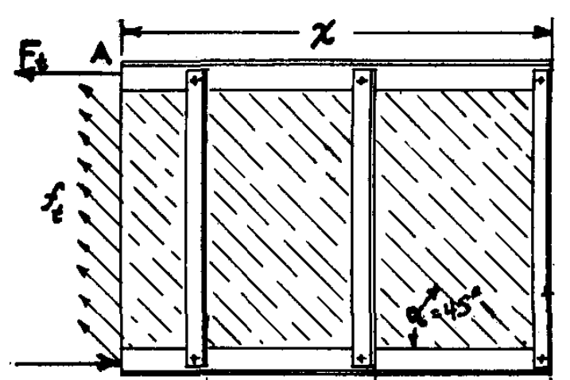{fig-align="center" width="80%"}

:::
::::::

<!-- ============================================================================================================================== -->
<!-- ============================================================================================================================== -->
<!-- ============================================================================================================================== -->