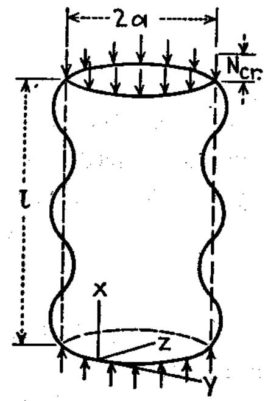
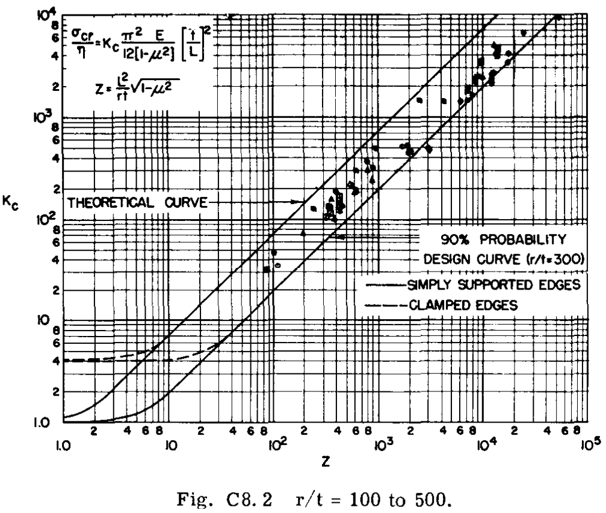

## Percurso da disciplina {.semester-map}

:::::::::: semester-grid
::: {.semester-item .done}
[01 · Introdução]{.semester-card-title}
:::

::: {.semester-item .done}
[02 · Métodos de otimização]{.semester-card-title}
:::

::: {.semester-item .done}
[03 · Método dos elementos finitos]{.semester-card-title}
:::

::: {.semester-item .current}
[04 · Método de densidades]{.semester-card-title}
:::

::: semester-item
[05 · Restrições de tensão e flambagem]{.semester-card-title}
:::

::: semester-item
[06 · Aplicações de otimização topológica]{.semester-card-title}
:::

::: semester-item
[07 · Projeto de estruturas]{.semester-card-title}
:::
::::::::::

```{python}
#| echo: false
#| include: false

import matplotlib.pyplot as plt

plt.rcParams["font.family"] = "Figtree"    # ou uma sans-serif próxima
plt.rcParams["font.size"] = 14            # tamanho base
plt.rcParams["axes.titlesize"] = 16       # títulos de eixos/plots
plt.rcParams["axes.labelsize"] = 14
plt.rcParams["xtick.labelsize"] = 12
plt.rcParams["ytick.labelsize"] = 12
plt.rcParams["legend.fontsize"] = 18

BLACK = "#2a2a2a"
BLUE = "#1f77b4"
GREEN = "#59a89c"
AMBAR = "#f0c571"
PURPLE = "#a559aa"
RED = "#e02b35"
GRAY = "#cecece"
```

<!-- ============================================================================================================================== -->

<!-- ============================================================================================================================== -->

<!-- ============================================================================================================================== -->

## Equação de Donnell

:::::: columns
::: {.column width="70%"}
Assim como em placas planas, a [equação diferencial para os deslocamentos $w(x, y)$]{.focus} pode ser obtida substituindo suas relações cinemáticas e constitutivas na equação de equilíbrio, mas incluindo agora uma curvatura $1/R$ do painel.

Para pequenas curvaturas relativas e considerando uma sistema de coordenadas $x$ longitudinal ao cilindro e $y$ ao longo da circunferência, podemos chegar na seguinte versão simplificada da equação de Donnell.

$$
D \nabla^4 w + \frac{Et}{R^2} w + t \left( \sigma_x \frac{\partial^2 w}{\partial x^2} + 2 \tau \frac{\partial^2 w}{\partial x \partial y} + \sigma_y\frac{\partial^2 w}{\partial y^2} \right) + p = 0
$$
:::

::: {.column width="5%"}
:::

::: {.column width="25%"}
{fig-align="center" width="100%"}
:::
::::::

<!-- ============================================================================================================================== -->

<!-- ============================================================================================================================== -->

<!-- ============================================================================================================================== -->

## Equação de Donnell

::::::: columns
:::: {.column width="70%"}
Podemos adotar condições de contorno como em placas nas suas bordas ([para o caso bi-apoiado $w(0, y) = w(L, y) = 0$ e $w_{xx}|_{(0, y)} = w_{xx}|_{(L, y)} = 0$]{.focus}), mas periódicas ao longo da circunferência ([$w(x, 0) = w(x, 2\pi R)$]{.focus}).

Para um cilindro simplemente apoiado, uma solução por série de Fourier pode ser assumida para o deslocamento transversal $w(x, y)$, assumindo um primeiro termo dominante da série, com $m$ meias-ondas ao longo do comprimento e $n$ meias-ondas ao longo da circunferência.

$$
w(x, y) = w_0 \sin\left(\frac{m \pi x}{L}\right) \cos\left(\frac{n y}{R}\right)
$$

::: callout-tip
## Para uma deflexão simétrica em relação ao eixo longitudinal:

$$
w(x) = w_0 \sin\left(\frac{m \pi x}{L}\right)
$$
:::
::::

::: {.column width="5%"}
:::

::: {.column width="25%"}
{fig-align="center" width="100%"}
:::
:::::::

<!-- ============================================================================================================================== -->

<!-- ============================================================================================================================== -->

<!-- ============================================================================================================================== -->

## Coeficiente de flambagem $k_c$

Substituindo a solução assumida na equação de Donnell, podemos obter uma expressão para a carga crítica de flambagem do cilindro simplesmente apoiado, nos moldes da obtida para placas:

$$
\sigma_{cr} = \frac{k_c \pi^2 E}{12(1 - \nu^2)} \left(\frac{t}{L}\right)^2
$$

:::::: columns
::: {.column width="45%"}
O [coeficiente de flambagem $k_c$]{.focus} depende do [modo de flambagem, $m$ e $n$]{.focus} (contido no termo $\beta = n L / m \pi r$) e de parâmetros geométricos do cilindro contidos no termo [$Z$ chamado parâmetro de Batdorf]{.focus}.

$$
k_c = \frac{(m^2 + \beta^2)^2}{m^2} + \frac{12 Z^2m^2}{\pi^4 (m^2 + \beta^2)^2}
$$

$$
Z = \frac{L^2}{R t} \sqrt{1 - \nu^2}
$$
:::

::: {.column width="5%"}
:::

::: {.column width="45%"}
Para o caso simplificado com deflexão axisimétrica, temos $n = 0$ e $\beta = 0$, e o coeficiente de flambagem se reduz a:

$$
k_c = m^2 + \frac{12 Z^2}{\pi^4 m^2}
$$
:::
::::::

<!-- ============================================================================================================================== -->

<!-- ============================================================================================================================== -->

<!-- ============================================================================================================================== -->

## Coeficiente de flambagem $k_c$ {.buckling-tabs}

```{python}
#| echo: false
#| include: false

import numpy as np
import matplotlib.pyplot as plt
from matplotlib import patheffects

# Configuração comum às duas abas
PLOT_WIDTH = 12.0
PLOT_HEIGHT = 6.5

AXIS_FONT = 20
TICK_FONT = 16
ANNOTATION_FONT = 17

BLACK = "#2a2a2a"
GRAY = "#cecece"
PAPER = "#ebe5e0"


def buckling_coefficient(Z, m):
    return m**2 + 12.0 * Z**2 / (m**2 * np.pi**4)


def plot_axisymmetric_modes(
    m_max,
    z_max,
    k_max,
    annotate_modes=False,
    show_linear=False,
    z_min=0.1,
    k_min=0.5,
):
    Z = np.geomspace(z_min, z_max, 1800)
    m_values = np.arange(1, m_max + 1)

    # Evita o extremo amarelo mais claro do viridis
    colors = plt.get_cmap("viridis")(
        np.linspace(0.05, 0.85, m_max)
    )

    with plt.rc_context({
        "font.family": ["Figtree", "DejaVu Sans"],
        "mathtext.fontset": "dejavusans",
        "axes.labelsize": AXIS_FONT,
        "xtick.labelsize": TICK_FONT,
        "ytick.labelsize": TICK_FONT,
        "text.color": BLACK,
        "axes.labelcolor": BLACK,
        "xtick.color": BLACK,
        "ytick.color": BLACK,
        "figure.facecolor": "white",
        "axes.facecolor": "white",
        "savefig.facecolor": "white",
        "savefig.transparent": False,
    }):
        fig, ax = plt.subplots(
            figsize=(PLOT_WIDTH, PLOT_HEIGHT)
        )

        fig.patch.set_facecolor("white")
        fig.patch.set_alpha(1.0)

        ax.set_facecolor("white")

        # Mesmas margens e área de plotagem nas duas abas
        fig.subplots_adjust(
            left=0.085,
            right=0.98,
            bottom=0.22,
            top=0.96,
        )

        for m, color in zip(m_values, colors):
            ax.plot(
                Z,
                buckling_coefficient(Z, m),
                color=color,
                linewidth=2.3 if m_max <= 5 else 1.1,
                alpha=1.0 if m_max <= 5 else 0.85,
                zorder=2,
            )

            if annotate_modes:
                # Anota onde o termo quadrático vale 25%
                # do termo constante: K = 1.25*m²
                z_label = 1#np.pi**2 * m**2 / np.sqrt(48.0)
                k_label = buckling_coefficient(z_label, m)

                if (
                    z_min < z_label < z_max
                    and k_min < k_label < k_max
                ):
                    text = ax.annotate(
                        rf"$m={m}$",
                        xy=(z_label, k_label),
                        xytext=(0, 7),
                        textcoords="offset points",
                        ha="center",
                        va="bottom",
                        fontsize=ANNOTATION_FONT,
                        color=color,
                        annotation_clip=True,
                        zorder=5,
                    )

                    # Halo discreto para separar texto e curva
                    text.set_path_effects([
                        patheffects.withStroke(
                            linewidth=1,
                            foreground=PAPER,
                        )
                    ])

        if show_linear:
            slope = 4.0 * np.sqrt(3.0) / np.pi**2

            ax.plot(
                Z,
                slope * Z,
                color=BLACK,
                linestyle="--",
                linewidth=2.5,
                zorder=4,
            )

            # Identificação direta da reta, sem legenda
            z_label = 3*10**2#0.25 * z_max
            k_label = 10**2#slope * z_label

            if k_min < k_label < k_max:
                text = ax.annotate(
                    r"$K \approx 0{,}702\,Z$",
                    xy=(z_label, k_label),
                    xytext=(0, -12),
                    textcoords="offset points",
                    ha="center",
                    va="top",
                    fontsize=ANNOTATION_FONT,
                    color=BLACK,
                    zorder=6,
                )

                text.set_path_effects([
                    patheffects.withStroke(
                        linewidth=1,
                        foreground="white",
                    )
                ])

        ax.set_xscale("log")
        ax.set_yscale("log")

        ax.set_xlim(z_min, z_max)
        ax.set_ylim(k_min, k_max)

        ax.set_xlabel(
            r"$Z=\dfrac{L^2}{Rh}\sqrt{1-\nu^2}$",
            labelpad=10,
        )
        ax.set_ylabel(r"$K$", labelpad=8)

        ax.set_axisbelow(True)

        ax.grid(
            which="major",
            color=BLACK,
            linewidth=0.8,
            alpha=0.30,
        )

        ax.grid(
            which="minor",
            color=GRAY,
            linewidth=0.5,
            alpha=0.65,
        )

        ax.tick_params(
            which="major",
            length=6,
            width=1,
        )
        ax.tick_params(
            which="minor",
            length=3,
            width=0.7,
        )

        for spine in ax.spines.values():
            spine.set_color(BLACK)
            spine.set_linewidth(0.9)

        return fig, ax
```

::: panel-tabset
### (a)

```{python}
#| echo: false
#| fig-format: svg
#| fig-align: center
#| out-width: "100%"

fig, ax = plot_axisymmetric_modes(
    m_max=5,
    z_max=100.0,
    k_max=100.0,
    annotate_modes=True,
    show_linear=False,
)

plt.show()
plt.close(fig)
```

### (b)

```{python}
#| echo: false
#| fig-format: svg
#| fig-align: center
#| out-width: "100%"

fig, ax = plot_axisymmetric_modes(
    m_max=100,
    z_max=10000.0,
    k_max=10000.0,
    annotate_modes=False,
    show_linear=True,
)

plt.show()
plt.close(fig)
```
:::

<!-- ============================================================================================================================== -->

<!-- ============================================================================================================================== -->

<!-- ============================================================================================================================== -->

## Coeficiente de flambagem $k_c$

Assim como para placas, o coeficiente de flambagem a ser utilizado deve ser o da curva de menor valor dentre as famílias observadas anteriormente, para o valor de $Z$ do cilindro em questão, onde observa-se agora um comportamento linear para $k_c(Z)$.

O coeficiente de flambagem pode ser obtido a partir de um problema de otimização, [minimizando a função $k_c(Z)$ em relação ao modo de flambagem]{.focus}, $m$ ou o termo completo $(m^2 + \beta^2)^2/m^2$. Fazendo $\partial k_c / \partial m = 0$ e substituindo na equação de $k_c$, obtêm-se:

$$
k_c = \frac{4 \sqrt{3}}{\pi^2} Z \approx 0.702 Z
$$

Este desenvolvimento assume um comportamento continuo de $m$, o que é uma aproximação razoável apenas para valores de $Z$ suficientemente grandes, como observado na região linear da curva de $k_c(Z)$ considerada a partir de $Z \geq 2,85$.

<!-- ============================================================================================================================== -->

<!-- ============================================================================================================================== -->

<!-- ============================================================================================================================== -->

## Flambagem axial: envoltória dos modos {.buckling-envelope}

```{python}
#| echo: false
#| fig-format: svg
#| fig-align: center
#| out-width: "100%"

import numpy as np
import matplotlib.pyplot as plt

# =========================================================
# CONTROLES
# =========================================================

L_OVER_R = 1.0

M_MAX = 100
N_MAX = 200

Z_MIN = 0.1
Z_MAX = 1.0e4
N_POINTS = 2000

K_MIN = 0.8
K_MAX = 1.0e4

PLOT_WIDTH = 12.0
PLOT_HEIGHT = 6.5

AXIS_FONT = 20
TICK_FONT = 16
ANNOTATION_FONT = 17

BLACK = "#2a2a2a"
BLUE = "#1f77b4"
GRAY = "#cecece"

# =========================================================
# ENVOLTÓRIA DOS MODOS
# =========================================================

def buckling_envelope(Z, l_over_r, m_max, n_max):
    n_values = np.arange(n_max + 1)
    beta = n_values * l_over_r / np.pi

    K_min = np.full(Z.size, np.inf)
    m_critical = np.zeros(Z.size, dtype=int)
    n_critical = np.zeros(Z.size, dtype=int)

    curvature_term = 12.0 * Z**2 / np.pi**4
    columns = np.arange(Z.size)

    for m in range(1, m_max + 1):
        q = (m**2 + beta**2)**2 / m**2

        K_modes = (
            q[:, None]
            + curvature_term[None, :] / q[:, None]
        )

        n_index = np.argmin(K_modes, axis=0)
        K_best_for_m = K_modes[n_index, columns]

        update = K_best_for_m < K_min

        K_min[update] = K_best_for_m[update]
        m_critical[update] = m
        n_critical[update] = n_values[n_index[update]]

    return K_min, m_critical, n_critical


Z = np.geomspace(Z_MIN, Z_MAX, N_POINTS)

K_envelope, m_critical, n_critical = buckling_envelope(
    Z,
    l_over_r=L_OVER_R,
    m_max=M_MAX,
    n_max=N_MAX,
)

# Verificação de sensibilidade ao truncamento dos modos
K_expanded, _, _ = buckling_envelope(
    Z,
    l_over_r=L_OVER_R,
    m_max=2 * M_MAX,
    n_max=2 * N_MAX,
)

relative_change = np.max(
    np.abs(K_envelope - K_expanded) / K_expanded
)

if relative_change > 1.0e-3:
    raise RuntimeError(
        "A envoltória variou mais de 0,1% ao dobrar os limites "
        "dos modos. Aumente M_MAX e N_MAX."
    )

# =========================================================
# FIGURA
# =========================================================

with plt.rc_context({
    "font.family": ["Figtree", "DejaVu Sans"],
    "mathtext.fontset": "dejavusans",
    "axes.labelsize": AXIS_FONT,
    "xtick.labelsize": TICK_FONT,
    "ytick.labelsize": TICK_FONT,
    "text.color": BLACK,
    "axes.labelcolor": BLACK,
    "xtick.color": BLACK,
    "ytick.color": BLACK,
    "figure.facecolor": "white",
    "axes.facecolor": "white",
    "savefig.facecolor": "white",
    "savefig.transparent": False,
}):
    fig, ax = plt.subplots(
        figsize=(PLOT_WIDTH, PLOT_HEIGHT),
        facecolor="white",
    )

    ax.set_facecolor("white")

    fig.subplots_adjust(
        left=0.12,
        right=0.97,
        bottom=0.23,
        top=0.95,
    )

    # Envoltória mínima
    ax.plot(
        Z,
        K_envelope,
        color=BLUE,
        linewidth=2.8,
        zorder=3,
    )

    ax.set_xscale("log")
    ax.set_yscale("log")

    ax.set_xlim(Z_MIN, Z_MAX)
    ax.set_ylim(K_MIN, K_MAX)

    ax.set_xlabel(
        r"$Z=\dfrac{l^2}{Rh}\sqrt{1-\mu^2}$",
        labelpad=10,
    )
    ax.set_ylabel(
        r"$k_{c,\mathrm{cr}}$",
        labelpad=8,
    )

    # Transição da aproximação contínua
    Z_CRITICAL = np.pi**2 / (2.0 * np.sqrt(3.0))

    ax.axvline(
        x=Z_CRITICAL,
        color=BLACK,
        linestyle="--",
        linewidth=2.0,
        zorder=4,
    )

    ax.annotate(
        r"$Z \approx 2{,}85$",
        xy=(Z_CRITICAL, 0.96),
        xycoords=("data", "axes fraction"),
        xytext=(8, 0),
        textcoords="offset points",
        ha="left",
        va="top",
        fontsize=ANNOTATION_FONT,
        color=BLACK,
        bbox=dict(
            facecolor="white",
            edgecolor="none",
            alpha=0.95,
            pad=3,
        ),
        zorder=5,
    )

    # Geometria usada na seleção dos modos circunferenciais
    ax.text(
        0.97,
        0.06,
        rf"$l/R={L_OVER_R:g}$",
        transform=ax.transAxes,
        ha="right",
        va="bottom",
        fontsize=ANNOTATION_FONT,
        color=BLACK,
        bbox=dict(
            facecolor="white",
            edgecolor="none",
            alpha=0.95,
            pad=3,
        ),
        zorder=5,
    )

    ax.set_axisbelow(True)

    ax.grid(
        which="major",
        color=BLACK,
        linewidth=0.8,
        alpha=0.30,
    )
    ax.grid(
        which="minor",
        color=GRAY,
        linewidth=0.5,
        alpha=0.70,
    )

    ax.tick_params(which="major", length=6)
    ax.tick_params(which="minor", length=3)

    for spine in ax.spines.values():
        spine.set_color(BLACK)
        spine.set_linewidth(0.9)

    plt.show()
    plt.close(fig)
```

<!-- ============================================================================================================================== -->

<!-- ============================================================================================================================== -->

<!-- ============================================================================================================================== -->

```{python}
#| echo: false
#| include: false

import numpy as np
import matplotlib.pyplot as plt

# =========================================================
# CONFIGURAÇÃO COMUM
# =========================================================

BLACK = "#2a2a2a"
GREEN = "#59a89c"
GRAY = "#cecece"

AXIS_FONT = 20
TICK_FONT = 16
LEGEND_FONT = 14

Z_CRITICAL = np.pi**2 / (2.0 * np.sqrt(3.0))
LINEAR_SLOPE = 4.0 * np.sqrt(3.0) / np.pi**2

Z_MIN = 0.1
Z_MAX = 1.0e4

K_MIN = 0.8
K_MAX = 1.0e4

Z = np.geomspace(Z_MIN, Z_MAX, 2000)

PLOT_STYLE = {
    "font.family": ["Figtree", "DejaVu Sans"],
    "mathtext.fontset": "dejavusans",
    "axes.labelsize": AXIS_FONT,
    "xtick.labelsize": TICK_FONT,
    "ytick.labelsize": TICK_FONT,
    "legend.fontsize": LEGEND_FONT,
    "text.color": BLACK,
    "axes.labelcolor": BLACK,
    "xtick.color": BLACK,
    "ytick.color": BLACK,
    "figure.facecolor": "white",
    "axes.facecolor": "white",
    "savefig.facecolor": "white",
    "savefig.transparent": False,
}


def knockdown_factor(r_over_t):
    r_over_t = np.asarray(r_over_t, dtype=float)

    # if np.any((r_over_t <= 0) | (r_over_t >= 1500)):
    #     raise ValueError("A expressão requer 0 < R/t < 1500.")

    phi = np.sqrt(r_over_t) / 16.0

    return 1.0 - 0.901 * (1.0 - np.exp(-phi))


def classical_envelope(s):
    s = np.asarray(s, dtype=float)

    return np.where(
        s <= Z_CRITICAL,
        1.0 + 12.0 * s**2 / np.pi**4,
        LINEAR_SLOPE * s,
    )


def style_axes(ax, logarithmic=False):
    ax.set_axisbelow(True)

    ax.grid(
        which="major",
        color=BLACK,
        linewidth=0.8,
        alpha=0.30,
    )

    if logarithmic:
        ax.grid(
            which="minor",
            color=GRAY,
            linewidth=0.5,
            alpha=0.70,
        )

    ax.tick_params(which="major", length=6)
    ax.tick_params(which="minor", length=3)

    for spine in ax.spines.values():
        spine.set_color(BLACK)
        spine.set_linewidth(0.9)


def plot_corrected_envelopes(rt_values):
    rt_values = list(rt_values)

    with plt.rc_context(PLOT_STYLE):
        fig, ax = plt.subplots(
            figsize=(12.0, 6.),
            facecolor="white",
        )

        # Margens idênticas nas duas abas
        fig.subplots_adjust(
            left=0.12,
            right=0.97,
            bottom=0.23,
            top=0.96,
        )

        # Curva teórica: sempre preta e tracejada
        ax.plot(
            Z,
            classical_envelope(Z),
            color=BLACK,
            linestyle="--",
            linewidth=2.6,
            label="Teórica",
            zorder=5,
        )

        if len(rt_values) == 1:
            colors = [GREEN]
        else:
            colors = plt.get_cmap("viridis")(
                np.linspace(0.05, 0.85, len(rt_values))
            )

        # Curvas corrigidas: sempre contínuas
        for rt, color in zip(rt_values, colors):
            gamma = float(knockdown_factor(rt))

            ax.plot(
                Z,
                classical_envelope(gamma * Z),
                color=color,
                linestyle="-",
                linewidth=2.4,
                label=rf"$R/t={rt:g}$",
                zorder=3,
            )

        ax.set_xscale("log")
        ax.set_yscale("log")

        ax.set_xlim(Z_MIN, Z_MAX)
        ax.set_ylim(K_MIN, K_MAX)

        ax.set_xlabel(
            r"$Z=\dfrac{L^2}{Rt}\sqrt{1-\nu^2}$",
            labelpad=10,
        )
        ax.set_ylabel(
            r"$k_{c,\mathrm{cr}}$",
            labelpad=8,
        )

        ax.legend(
            loc="upper left",
            frameon=True,
            facecolor="white",
            edgecolor=GRAY,
            framealpha=0.95,
        )

        style_axes(ax, logarithmic=True)

        return fig, ax
```

<!-- ===================== Slide 1 ===================== -->

## Fator de knockdown {.knockdown-slide}

::::::: columns
::: {.column width="48%"}
O modelo clássico considera uma casca perfeita. Para representar a redução da resistência observada experimentalmente, introduzimos um [fator de knockdown]{.focus}, $\gamma$.

Para a compressão axial, adotamos a expressão empírica:

$$
\gamma=1-0{,}901\left(1-e^{-\phi}\right)
$$

com

$$
\phi=\frac{1}{16}\sqrt{\frac{R}{t}},
\qquad \frac{R}{t}<1500.
$$

Quanto maior a razão $R/t$, menor o fator $\gamma$ e maior a redução prevista em relação à solução clássica.

Na curva de coeficientes, aplicamos a correção por meio de [$k_{c,\mathrm{corr}}=f(\gamma Z)$]{.focus}, sendo $k_{c,\mathrm{teo}}=f(Z)$.
:::

::: {.column width="4%"}
:::

:::: {.column width="48%"}
::: panel-tabset
### Bhrun

{fig-align="center" width="100%"}

### Fator de *knockdown*

```{python}
#| echo: false
#| fig-format: svg
#| fig-align: center
#| out-width: "100%"

rt_values = np.linspace(10.0, 1499.0, 1200)

with plt.rc_context(PLOT_STYLE):
    fig, ax = plt.subplots(
        figsize=(6.0, 5.0),
        facecolor="white",
    )

    fig.subplots_adjust(
        left=0.18,
        right=0.96,
        bottom=0.18,
        top=0.96,
    )

    # Curva única: preta, sem marcadores ou linhas auxiliares
    ax.plot(
        rt_values,
        knockdown_factor(rt_values),
        color=BLACK,
        linewidth=2.6,
    )

    ax.set_xlabel(r"$R/t$", labelpad=8)
    ax.set_ylabel(r"$\gamma$", labelpad=8)

    ax.set_xlim(0, 1500)
    ax.set_ylim(0, 1.05)

    ax.set_xticks([0, 500, 1000, 1500])
    ax.set_yticks(np.arange(0, 1.01, 0.2))

    style_axes(ax)

    plt.show()
    plt.close(fig)
```
:::
::::
:::::::

<!-- ===================== Slide 2 ===================== -->

## Correções semi-empíricas

::: panel-tabset
### Correção para R/t = 500

```{python}
#| echo: false
#| fig-format: svg
#| fig-align: center
#| out-width: "100%"

fig, ax = plot_corrected_envelopes( [500])

plt.show()
plt.close(fig)
```

### Diferentes razões R/t

```{python}
#| echo: false
#| fig-format: svg
#| fig-align: center
#| out-width: "100%"

fig, ax = plot_corrected_envelopes(
     [100, 300, 500, 750, 1000, 1500, 2000, 3000]
)

plt.show()
plt.close(fig)
```
:::