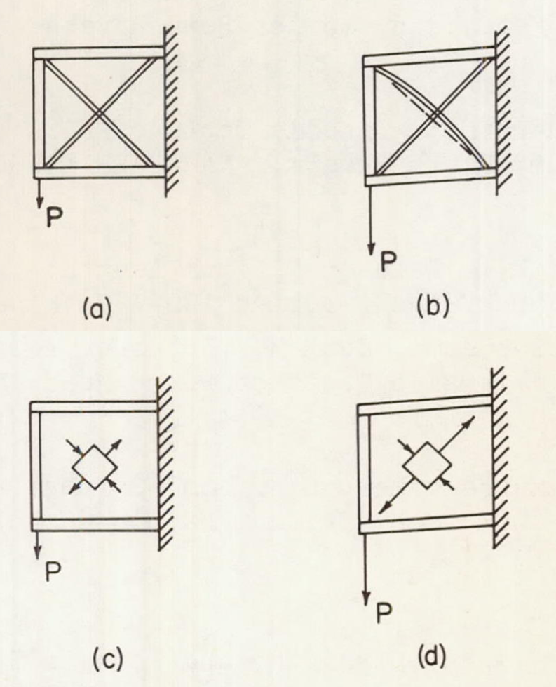
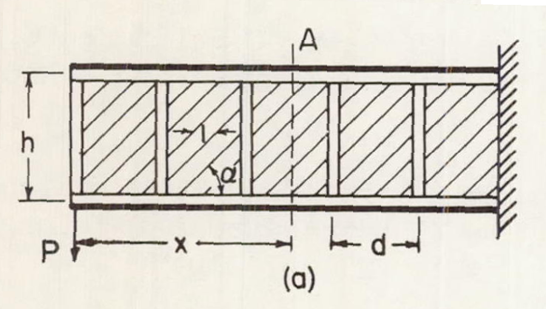
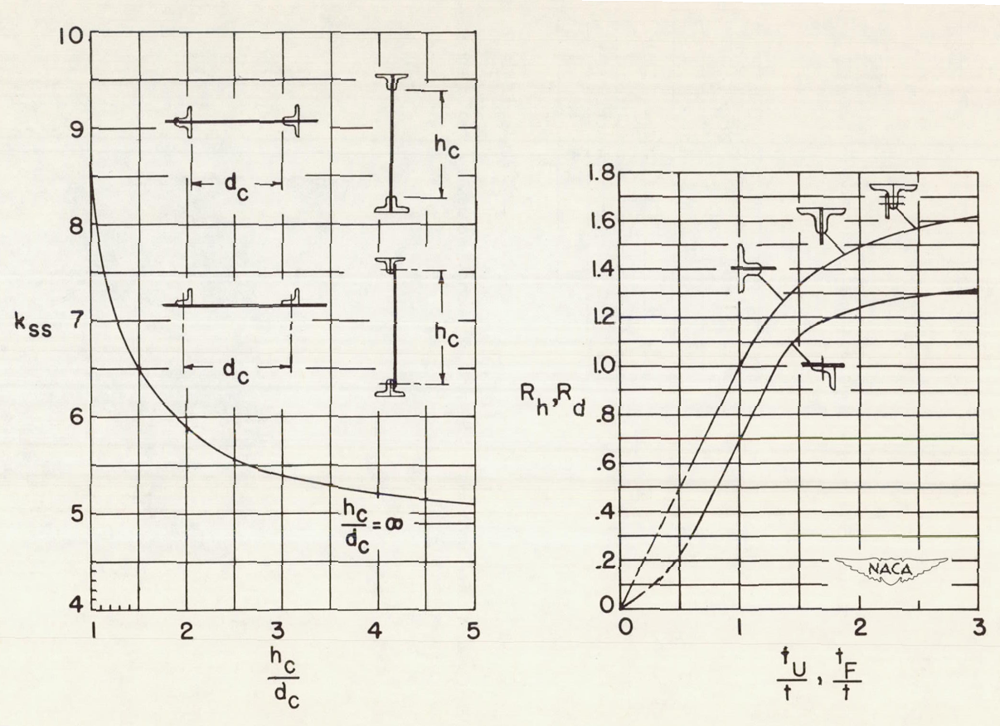
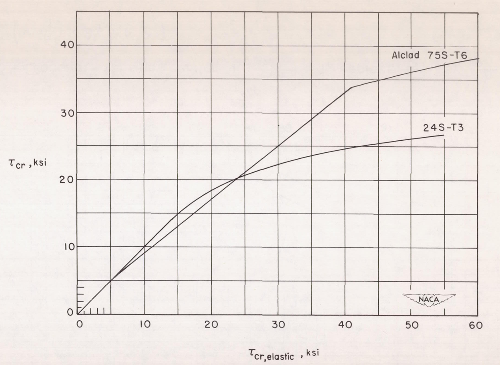
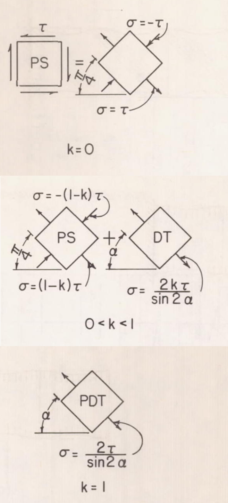
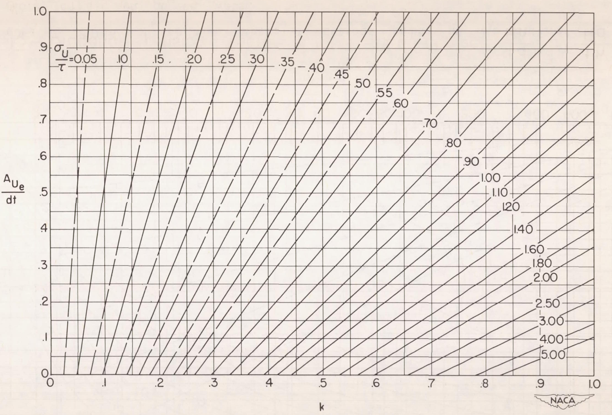
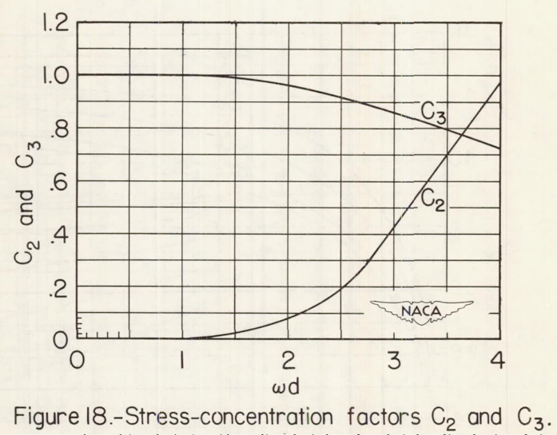
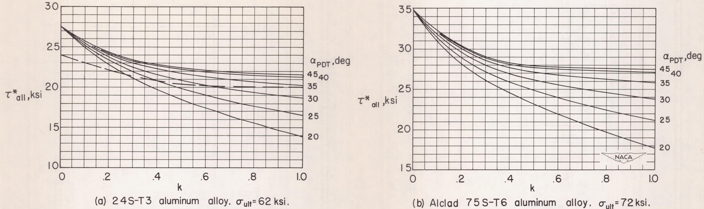
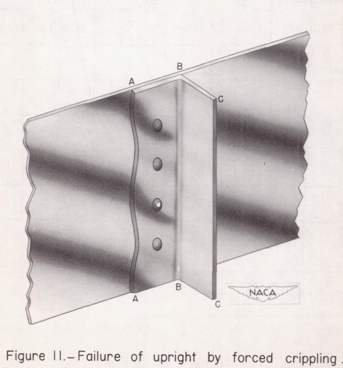
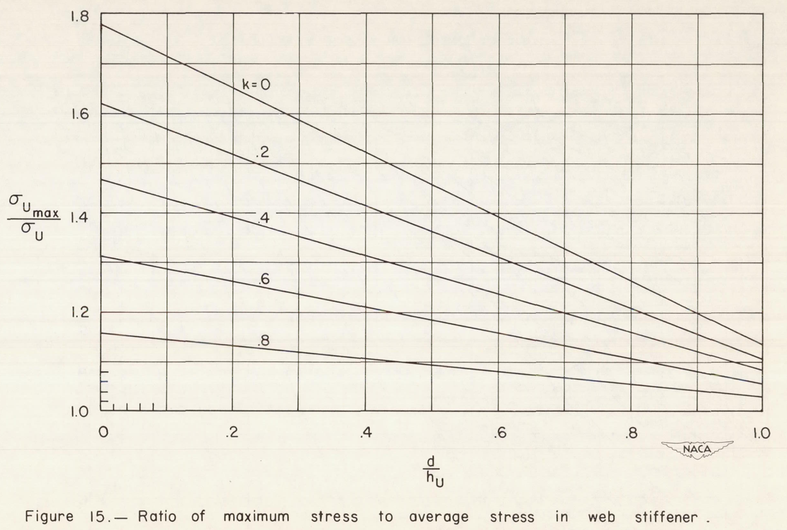

## Tração diagonal incompleta {.semester-map}

:::::::::: semester-grid
::: {.semester-item}
[01 · Introdução]{.semester-card-title}
:::

::: {.semester-item}
[02 · Tração diagonal pura]{.semester-card-title}
:::

::: {.semester-item}
[03 · Tração diagonal incompleta]{.semester-card-title}
:::

::::::::::

```{python}
#| echo: false
#| include: false

import matplotlib.pyplot as plt

plt.rcParams["font.family"] = "Figtree"    # ou uma sans-serif próxima
plt.rcParams["font.size"] = 14            # tamanho base
plt.rcParams["axes.titlesize"] = 16       # títulos de eixos/plots
plt.rcParams["axes.labelsize"] = 14
plt.rcParams["xtick.labelsize"] = 12
plt.rcParams["ytick.labelsize"] = 12
plt.rcParams["legend.fontsize"] = 18

BLACK = "#2a2a2a"
BLUE = "#1f77b4"
GREEN = "#59a89c"
AMBAR = "#f0c571"
PURPLE = "#a559aa"
RED = "#e02b35"
GRAY = "#cecece"
```

<!-- ============================================================================================================================== -->
<!-- ============================================================================================================================== -->
<!-- ============================================================================================================================== -->

## Introdução

:::::: columns
::: {.column width="50%"}

Tratando da tração diagonal pura (ou completa) consideramos o caso extremo onde a placa perde sua capacidade de carga sob compressão completamente.

No entanto, após a flambagem na maioria dos casos práticos, uma [parte dessa resistência ainda se mantém]{.focus} caracterizando uma tração diagonal incompleta.

Neste novo caso, [métodos semi-empíricos]{.focus} devem ser utilizados para tratar a análise de tensões e deformações.


:::

::: {.column width="5%"}
:::

::: {.column width="45%"}
{fig-align="center" width="70%"}
:::
::::::


<!-- ============================================================================================================================== -->
<!-- ============================================================================================================================== -->
<!-- ============================================================================================================================== -->


## Fator de tração diagonal

:::::: columns
::: {.column width="50%"}

Consideramos que o [cisalhamento presente na alma pode ser dividido em duas parcelas]: um cisalhamento verdadeiro $\tau$ e um cisalhamento devido à tração diagonal $\tau_{DT}$.

[O fator de tração diagonal $k$ define a proporção em que o cisalhamento se divide]{.focus} para as duas parcelas definidas anteriormente.

O valor de $k$ varia entre $k$ = 0 para uma placa não flambada e $k$ = 1 para um estado de tração diagonal pura.  

Na região intermediária seu valor pode ser obtido através da seguinte relação empírica a qual depende da razão de carregamento $\tau/\tau_{CR}$.

:::

::: {.column width="5%"}
:::

::: {.column width="45%"}
$$
\tau = \tau_s + \tau_{DT}
$$

\

\

$$
\tau_s = (1 - k) \tau \qquad \text{e} \qquad \tau_{DT} = k \tau
$$

\

\

$$
k = \tanh{0.5 \log_{10}{\frac{\tau}{\tau_{cr}}}}
$$

:::
::::::

<!-- ============================================================================================================================== -->
<!-- ============================================================================================================================== -->
<!-- ============================================================================================================================== -->
## Tensões críticas de flambagem

:::::: columns
::: {.column width="50%"}

Na razão de carregamento, a tensão de cisalhamento atuante é dividida pela tensão crítica de flambagem da placa. 

Essa tensão crítica depende das [restrições nas bordas impostas pelos reforçadores ($R_h$) e pelas flanges ($R_d$)]{.focus}, além do coeficiente de flambagem $k_{ss}$.

Os termos $R_h$ e $R_d$ são valores empíricos descritos em função das razões entre as espessuras da flange e da alma ($t_F/t$) e do reforçador e da alma ($t_U/t$).

Para valores de tensão acima do limite de escoamento do material, devem ser utilizadas correções plásticas, conforme os ábacos a seguir.

:::

::: {.column width="5%"}
:::

::: {.column width="45%"}

{fig-align="center" width="85%"}

\

$$
\tau_{cr,\mathrm{elastic}}
=
k_{ss}E
\left(\frac{t}{b}\right)^2
\left[
R_h
+
\frac{1}{2}(R_d-R_h)
\left(\frac{d}{h}\right)^3
\right]
$$


:::
::::::


<!-- ============================================================================================================================== -->
<!-- ============================================================================================================================== -->
<!-- ============================================================================================================================== -->


## Coeficiente de flambagem e fatores de restrição

{fig-align="center" width="60%"}


<!-- ============================================================================================================================== -->
<!-- ============================================================================================================================== -->
<!-- ============================================================================================================================== -->


## Correção plástica

{fig-align="center"  width="60%"}


<!-- ============================================================================================================================== -->
<!-- ============================================================================================================================== -->
<!-- ============================================================================================================================== -->


## Análise de tensões

:::::: columns
::: {.column width="50%"}

A partir do fator $k$ e do ângulo de tração diagonal $\alpha$, podemos calcular as [tensões que surgem após a flambagem]{.focus} na direção de $\alpha$ ($\sigma_1$) e na direção perpendicular a ela ($\sigma_2$).

$$
\sigma_1
=
\frac{2k\tau}{\sin 2\alpha}
+
\tau(1-k)\sin 2\alpha
$$

\

$$
\sigma_2
=
-\tau(1-k)\sin 2\alpha
$$

Quando [$k$ se aproxima de 1]{.focus}, recuperamos as relações para a [tração diagonal pura]{.focus}.

:::

::: {.column width="5%"}
:::

::: {.column width="45%"}

{fig-align="center" width="40%"}

:::
::::::


<!-- ============================================================================================================================== -->
<!-- ============================================================================================================================== -->
<!-- ============================================================================================================================== -->


## Tensões nos reforçadores verticais

:::::: columns
::: {.column width="50%"}

Assim como na tração diagonal pura, essas tensões devem ser decompostas nas direções vertical e horizontal para o cálculo de seus efeitos nas flanges e nos reforçadores.

Como a [alma ainda suporta tensões de compressão]{.focus}, podemos considerar uma [largura efetiva]{.focus} que contribui para a resistência dos reforçadores verticais.

Incluindo essa contribuição da alma e considerando uma área efetiva dos reforçadores, que incorpora os efeitos de excentricidade, podemos calcular a [tensão média nos reforçadores ($\sigma_U$)]{.focus} pela relação ao lado.

:::

::: {.column width="5%"}
:::

::: {.column width="45%"}

$$
\frac{b_e}{b}
=
0.5(1-k)
$$

\

\

$$
\sigma_U
=
-\frac{k\tau\tan\alpha}
{\dfrac{A_u}{dt}+0.5(1-k)}
$$

:::
::::::


<!-- ============================================================================================================================== -->
<!-- ============================================================================================================================== -->
<!-- ============================================================================================================================== -->


## Tensões nas flanges

:::::: columns
::: {.column width="50%"}

Analogamente, uma [tensão adicional nas flanges]{,focus} pode ser calculada pela seguinte relação:

$$
\sigma_F
=
-\frac{k\tau\cot\alpha}
{\dfrac{2A_F}{ht}+0.5(1-k)}
$$

Para calcular o ângulo de tração diagonal, devemos novamente encontrar o valor que minimiza a energia de deformação da estrutura.

Para placas planas, os valores de $\alpha$ normalmente se encontram entre $38^\circ$ e $45^\circ$.

:::

::: {.column width="5%"}
:::

::: {.column width="45%"}

$$
\tan^2\alpha
=
\frac{\varepsilon-\varepsilon_F}
{\varepsilon-\varepsilon_U}
$$

\

$$
\varepsilon_F = \frac{\sigma_F}{E}
\qquad
\varepsilon_U = \frac{\sigma_U}{E}
$$

\

$$
\varepsilon
=
\frac{1}{E}(\sigma_1-\mu\sigma_2)
$$

:::
::::::


<!-- ============================================================================================================================== -->
<!-- ============================================================================================================================== -->
<!-- ============================================================================================================================== -->


## Análise de tensões

Ao contrário do que observamos na tração diagonal completa, [as relações para o ângulo de tração diagonal e para as tensões nos componentes ($\sigma_F$ e $\sigma_U$) são acopladas e devem ser resolvidas iterativamente]{.focus}.

1\. Assume-se um valor inicial de $\alpha$, utilizado para calcular as tensões $\sigma_F$, $\sigma_U$, $\sigma_1$ e $\sigma_2$.

2\. A partir dessas tensões, calculam-se as deformações $\varepsilon_F$, $\varepsilon_U$ e $\varepsilon$.

3\. Os valores das deformações são utilizados para atualizar $\alpha$, repetindo-se o processo até a convergência.

[Quando a rigidez das flanges é significativamente maior que a da alma]{.focus}, $\varepsilon_F$ é pouco significativa em comparação com $\varepsilon$. Nesse caso, o processo iterativo pode ser evitado, e as tensões nos reforçadores verticais podem ser calculadas diretamente pelo ábaco a seguir.


<!-- ============================================================================================================================== -->
<!-- ============================================================================================================================== -->
<!-- ============================================================================================================================== -->


## Análise de tensões

{fig-align="center" width="65%"}


<!-- ============================================================================================================================== -->
<!-- ============================================================================================================================== -->
<!-- ============================================================================================================================== -->


## Modos de falha: Ruptura da alma

Após a análise das tensões no estado de tração diagonal e a determinação de $k$ e $\alpha$, podemos utilizar essas informações para avaliar a [falha dos componentes individuais.]{.focus}


Para cargas elevadas após a flambagem, a alma pode falhar por ruptura do material ao atingir uma tensão de cisalhamento máxima $\tau'_{\max}$, definida em função de uma correção $C_1$ para o ângulo $\alpha$ e de uma correção $C_2$ para a concentração de tensões.

\

$$
\tau'_{\max}
=
\tau(1+k^2C_1)(1+kC_2)
$$

\

$$
C_1
=
\frac{1}{\sin 2\alpha}-1
$$


<!-- ============================================================================================================================== -->
<!-- ============================================================================================================================== -->
<!-- ============================================================================================================================== -->


## Modos de falha: Ruptura da alma

:::::: columns
::: {.column width="45%"}

O fator de correção $C_2$ pode ser obtido graficamente em função do parâmetro $\omega d$, calculado conforme indicado no gráfico.

Os termos $I_T$ e $I_C$ representam, respectivamente, os momentos de inércia das flanges sob tração e sob compressão.

$$
\omega d
=
0.7b
\sqrt[4]{
\frac{t}{(I_C+I_T)d_e}
}
$$

:::

::: {.column width="5%"}
:::

::: {.column width="50%"}

{fig-align="center" width="100%"}

:::
::::::


<!-- ============================================================================================================================== -->
<!-- ============================================================================================================================== -->
<!-- ============================================================================================================================== -->


## Modos de falha: Ruptura da alma

As tensões máximas calculadas devem ser comparadas com os valores admissíveis, conforme mostrado nos gráficos abaixo para os alumínios das classes 24S e 75S.

Observamos para este caso que os [valores admissíveis não são dependentes apenas do material, mas também do estado de deformação]{.focus}.

\

{fig-align="center" width="100%"}


<!-- ============================================================================================================================== -->
<!-- ============================================================================================================================== -->
<!-- ============================================================================================================================== -->


## Modos de falha: Falha dos reforçadores verticais

Ao analisarmos os reforçadores verticais, podemos observar alguns modos de falha distintos: [falha como coluna, falha local e falha local forçada.]{.focus}

Na [falha como coluna]{.focus}, ao se iniciar a flambagem do reforçador, calculada pela equação de Euler, as tensões na alma desenvolvem uma força restauradora que se opõe à deflexão. Esse efeito pode ser incluído na análise de flambagem por meio da modificação do comprimento efetivo ($L_e$) da coluna, conforme a seguinte relação:

$$
L_e
=
\frac{d_U}
{\sqrt{
1+k^2\left(3-2\frac{d}{h_U}\right)
}}
\qquad
(d<1.5h_U)
$$

O comprimento do reforçador $d_U$ deve ser medido entre os centroides das linhas de rebites que o conectam às flanges.


<!-- ============================================================================================================================== -->
<!-- ============================================================================================================================== -->
<!-- ============================================================================================================================== -->


## Modos de falha: Falha dos reforçadores verticais

:::::: columns
::: {.column width="55%"}

A [falha local das seções dos reforçadores]{.focus} normalmente não é dominante na análise desses elementos, mas seu efeito combinado com a falha como coluna pode ser investigado por meio da equação de [Johnson–Euler]{.focus}.

As ondas de flambagem da alma podem forçar a flambagem dos reforçadores, principalmente quando estes apresentam pequena espessura na região de conexão, caracterizando a chamada [falha local forçada]{.focus}.

Esse tipo de falha, aplicável a reforçadores simples ou simétricos, normalmente constitui o modo dominante no projeto desses elementos.

:::

::: {.column width="5%"}
:::

::: {.column width="40%"}

{fig-align="center" width="100%"}

:::
::::::


<!-- ============================================================================================================================== -->
<!-- ============================================================================================================================== -->
<!-- ============================================================================================================================== -->


## Modos de falha: Falha local forçada

:::::: columns
::: {.column width="48%"}

Para [reforçadores duplos]{.focus}, as seguintes relações podem ser utilizadas para estimar as tensões admissíveis para a falha local forçada.


$$
\sigma_o
=
21k^{2/3}
\left(\frac{t_U}{t}\right)^{1/3}
\ \text{ksi}
\qquad
\text{(24S-T3)}
$$

\

$$
\sigma_o
=
26k^{2/3}
\left(\frac{t_U}{t}\right)^{1/3}
\ \text{ksi}
\qquad
\text{(75S-T6)}
$$

:::

::: {.column width="4%"}
:::

::: {.column width="48%"}

Para [reforçadores simples]{.focus}, podem ser utilizadas estimativas diferentes.

\

$$
\sigma_o
=
26k^{2/3}
\left(\frac{t_U}{t}\right)^{1/3}
\ \text{ksi}
\qquad
\text{(24S-T3)}
$$

\

$$
\sigma_o
=
32.5k^{2/3}
\left(\frac{t_U}{t}\right)^{1/3}
\ \text{ksi}
\qquad
\text{(75S-T6)}
$$

:::
::::::


<!-- ============================================================================================================================== -->
<!-- ============================================================================================================================== -->
<!-- ============================================================================================================================== -->


## Modos de falha: Tensão máxima nos reforçadores

:::::: columns
::: {.column width="45%"}

Devido ao caráter local desse tipo de falha, não devemos comparar as tensões admissíveis com as tensões $\sigma_U$, que representam valores médios ao longo do reforçador.

A comparação deve ser feita com os valores máximos dessas tensões, que podem ser obtidos graficamente.

Para [análise das flanges]{.focus} apenas os modos clássicos para estes elementos podem ser avaliadas como a Flambagem como coluna, Falha local (e interação entre elas) e falhas por cisalhamento ou ruptura do material utilizado.

:::

::: {.column width="5%"}
:::

::: {.column width="50%"}

{fig-align="center" width="100%"}

:::
::::::


